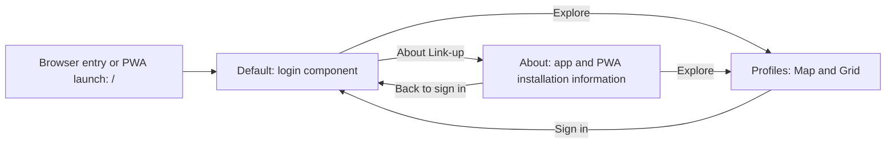

# Link-up Design Choices

## Contents

- [Overview](#overview)
- [Locality](#locality)
- [Profiles](#profiles)
- [Messaging](#messaging)
- [Architecture](#architecture)
- [Lifecycles and Flows](#lifecycles-and-flows)
- [Build Steps](#build-steps)
- [File Structure](#file-structure)

## Overview

Link-up is a free messenger.  Communication between people should be free, similar to the principles of the [Zen of Reticulum](https://reticulum.network/zenofreticulum.html).  Private data remains private unless given express permission.  No data is sold or used otherwise.  Link-up is an app helping people to connect for dating with a focus on gay men looking for gay men.  Eventually, it may be an umbrella app for a series of web properties each with their own branding.

Link-up targets $0 ongoing operating costs at launch, with any later costs small enough for limited ad revenue to cover. Limited ad spots are the only planned revenue source.

Link-up is a local-first, mobile-first Progressive Web App (PWA). It runs in a browser and can be installed where the platform supports PWAs.

## Locality

A user's profile location must remain useful for locality search while exposing only the precision the user permits. The privacy amount is configurable. The initial policy model supports two modes: users who choose locality privacy are represented at city-level precision, while users who choose precise location may be represented within a few meters. The design must not expose a more precise profile location than the selected mode permits.

The planned approach uses geographic cells to organize nearby discovery and locally cached reference data to resolve locality names. Location processing and discovery are not yet implemented. See [Locality design](locality-design.md) for the proposed components, search, caching, update rules, and service exclusions.

## Profiles

Users should be able to create and update their locally stored Link-up profile, share it with other Link-up users, and view profiles shared with them. The Profiles page should display search results for nearby users who are online in Map and Grid views, with facets to narrow the search. The information included in a profile has not yet been decided.

The current Profiles page uses sample data and an illustrative map. Switching between Map and Grid and selecting the grid's column count are implemented. Profile editing, sharing, and live search are not yet implemented. The detailed discovery and search proposals are described in [Network and Search Decisions](network-search-decisions.md).

## Messaging

Users should be able to send and receive private messages with other Link-up users, with message history stored locally on the user's device. The installed PWA should integrate with platform notifications where supported.

The planned browser messaging library is [Converse](https://conversejs.org/docs/), using XMPP. Messaging is not yet implemented. The XMPP server and connection configuration, message encryption, and delivery while Link-up is not active remain undecided. Messaging infrastructure must preserve local data authority.

## Architecture

### Local Authority and Storage

Link-up is hard local-first. Its essential business logic executes locally, and its authoritative user data remains under the user's control.

User-owned data, including profile data and images, has its definitive copy on the user's device. This data must remain encrypted. It may be replicated elsewhere when required for sharing or search without displacing the local definitive copy.

Application data that is not user-owned is also stored locally first. It may be synchronized with a backend when it is not shipped as static data.

### Code Organization and Responsibilities

Browser code is organized by responsibility. Shared initialization handles common browser listeners and service-worker registration. Feature logic, persistence, networking, and page-specific behavior belong in separate modules, initialized through the shared entry point when needed. Web components encapsulate reusable interface elements such as the login form.

The browser application uses vanilla JavaScript and HTML with standard browser and PWA APIs. It owns the interface, local state, and essential application logic. The server serves the application and may provide supporting network capabilities. Server framework choices are independent of browser libraries.

### Runtime and Network Boundaries

Link-up runs in supported browsers and as an installed PWA, within the browser security model. Browser and installed-PWA capabilities must account for platform support.

Peer-to-peer exchange is preferred wherever practical. Signalling, relays, discovery, synchronization, and notification delivery may rely on remote services. These services may replicate or synchronize data without becoming its authoritative home. Peer transport and integration remain undecided.

Bun provides build tooling and the executable application host. The host embeds the completed PWA assets and serves them through HTTP routes. Generated build output is never edited directly.

### Browser and Host Libraries

The browser interface uses vanilla JavaScript, HTML, Milligram CSS, and standard browser and PWA APIs. Bun installs dependencies, runs project tasks, stages browser assets, and compiles the application host.

### Local Storage Proposal

Local application data is planned to use [granthdb](https://granthlabs.github.io/), using SQLite/WASM with OPFS persistence and an IndexedDB fallback. The schema, data lifecycle, and user-controlled export path have not yet been decided.

The proposed local storage boundary is:

```text
Link-up PWA ↔ granthdb ↔ SQLite/WASM ↔ OPFS (IndexedDB fallback)
```

The integration between local application storage and Converse's message persistence remains an open decision.

Geographic reference data changes slowly enough to be shipped statically; when its size makes that impractical, it can be segmented by locality and cached on demand. See [Locality design](locality-design.md) for the detailed proposal.

### Peer Connection Boundary

```text
Link-up peer ↔ untrusted network and signalling/relay infrastructure ↔ Link-up peer
```

The peer transport has not yet been selected. If direct peer connections are used, their privacy implications and whether relay-only connections are required must be resolved before peer networking ships.

### Host and Asset Packaging

The production deployment artifact is `dist/link-up`, a full-stack executable for VPS deployment. It embeds the completed PWA assets and serves them through its local HTTP routes. Its current host listens on `127.0.0.1` with an operating-system-assigned port (`port: 0`) and logs the selected URL at startup; any public VPS-facing proxy or TLS arrangement is outside this project's current design.

All shipped application source lives under `src/`, organized by responsibility: `web/` contains the browser application, and `server/` contains the executable host. The build copies `web/` into `dist/` and stages third-party browser assets from `node_modules/` into `dist/external/`, preserving browser asset URLs. `dist/` is generated build output and is never edited directly.

### Server and Browser Responsibilities

| Responsibility | Link-up browser application | Link-up server |
| --- | --- | --- |
| Routing | Page navigation and any client-side route handling | Matching HTTP requests to page, asset, or API handlers |
| Requests and responses | Making network requests and processing results; service-worker interception | Receiving HTTP requests and returning responses |
| Shared processing | Application initialization, browser events, and service-worker hooks | Middleware around HTTP handlers, such as authentication, validation, and logging |
| UI and data | Rendering the interface, managing local state, and keeping authoritative user data | Serving application assets and providing supporting network capabilities |

The Bun host uses Bun's native HTTP APIs. A server framework would be evaluated for the Bun host independently of browser libraries. Adding server middleware does not require a browser framework or move essential application logic and authoritative data off-device.

### Browser Initialization

`src/web/scripts/appInit.js` is the shared browser entry point loaded by Default, Profiles, and About. It configures the share button where the Web Share API is supported and registers `./sw.min.js` on the window's `load` event where service workers are supported.

The Default page loads the reusable login component from `src/web/components/login.js`. Profiles loads `src/web/scripts/profiles.js` for Map/Grid switching and grid column selection.

### Service-Worker Configuration

The build injects Workbox's asset manifest into the service worker, then bundles it into `dist/sw.min.js`. The worker passes the manifest to `precacheAndRoute(self.__WB_MANIFEST, { directoryIndex: "" })`.

The build maps `default.html` to `/` in the precache manifest. Navigation requests for `/`, `/default`, and `/default.html` use a network-only Workbox route with the precached `/` as a fallback. Other matching precache requests use cache-first behavior, with a network fallback if a required cache entry is missing. Requests outside these routes use the network.

During installation, Workbox downloads new or changed resources and reuses unchanged cached resources. During activation, it removes precache entries that are absent from the current manifest.

The `version` property in `package.json` is the authoritative application version, using `MAJOR_VERSION.YYYYMMDD`. GitHub Actions updates the date after branch pushes using the push date in `America/New_York`; the major number changes manually. Workbox manages precache identity and invalidation through the generated asset revisions. The browser registers the service worker at `./sw.min.js` and uses the service-worker update lifecycle to install and activate changed builds.

## Lifecycles and Flows

### Application Initialization

```text
Page loads → shared listeners are configured → window load → service-worker registration
```

The shared browser entry point is loaded by Default, Profiles, and About. It sets up common listeners and registers the service worker when supported. Page-specific modules initialize their own behavior. Feature persistence and networking initialization remain future work.

### Page Flow



The manifest has one stable start URL, `/`, which serves Default. The diagram shows the existing public page links. The login component is currently a placeholder; authentication and navigation after sign-in are not yet implemented.

### Connectivity

```text
Online → sustained loss of connectivity → blocking offline overlay → connectivity restored → overlay removed
```

The application requires network access for all functionality. Local-first refers to local data authority and execution.

The planned shaded overlay covers the current page, blocks interaction, and states “The app is offline.” The underlying page remains in place. Brief interruptions, such as a ten-second drop, should not trigger it. The overlay and its timing rules are not yet implemented.

### Service-Worker Lifecycle

```text
First visit → service-worker installation and precaching → activation → controlled page requests
Changed build → new worker installation → activation when permitted by the browser lifecycle
```

The first visit loads over the network while the service worker installs. Workbox caches the build's resources by content revision and removes obsolete precache entries during activation. Controlled pages can then load cached resources; the entry page checks the network first and falls back to its cached copy. Cached resources support loading the interface during connectivity loss; the intended interaction restriction is described above.

Changed builds use the browser's service-worker update lifecycle. See [Service-worker configuration](#service-worker-configuration) for the current routing and versioning details.

## Build Steps

The build environments are development and production. Each top-level command independently calls shared internal functions; top-level commands do not call one another.

- `bun run build:dev` calls `buildDev()`: bundle for development, then run tests.
- `bun run start:dev` calls `startDev()`: bundle for development, run tests, then start the local server from source.
- `bun run deploy:prod` calls `deployProd()`: bundle for production, then run tests. Deployment is currently a TODO.

`NODE_ENV` comes from `.env` files: `.env.local` sets `dev` locally, `.env` sets `prod`, and `runTests()` loads `.env.test` with `test` after excluding the inherited `NODE_ENV`. `bundleApplication()` performs these stages in order:

1. In `clean()`, delete `dist/` if it exists.
2. In `copyBuildFiles()`, copy the PWA pages, manifest, and static assets from `src/web/` into `dist/`, then stage HTMX and Milligram from `node_modules/` into `dist/external/`.
3. In `removeComments()`, remove HTML comments from the copied pages.
4. In `bundleClientJs()`, inject the Workbox asset manifest into intermediate `dist/sw.js`, bundle and minify it into `dist/sw.min.js`, then remove `dist/sw.js`.
5. In `bundleServerExecutable()`, compile `src/server/server.js` and its route-embedded assets into `dist/link-up`.

All three commands call `runTests()` after bundling. A build or test failure stops the workflow; `startDev()` calls `startServer()` only after tests pass. Deploy the production `dist/link-up` only when `bun run deploy:prod` succeeds (exit code 0). Automatic deployment is not implemented.

`bun test --env-file=.env.test` runs the test suite in the test environment without bundling first.

## File Structure

```text
.
├── build.js
├── bun.lock
├── jsconfig.json
├── package.json
├── docs/
│   ├── DESIGN.md
│   ├── locality-design.md
│   └── archived/
│       └── locality-diagram.png
├── src/
│   ├── web/
│   │   ├── components/
│   │   ├── images/
│   │   ├── manifest.json
│   │   ├── pages/
│   │   │   ├── about.html
│   │   │   ├── default.html
│   │   │   └── profiles.html
│   │   ├── scripts/
│   │   │   ├── appInit.js
│   │   │   └── profiles.js
│   │   ├── styles/
│   │   │   └── global.css
│   │   └── sw.js
│   └── server/
│       ├── routes.js
│       └── server.js
├── test/
│   ├── app.test.js
│   ├── build.test.js
│   └── sw.test.js
└── dist/                         generated
    ├── external/                 staged third-party browser assets
    │   ├── htmx.min.js
    │   └── milligram.min.css
    └── link-up                   VPS deployment executable
```
